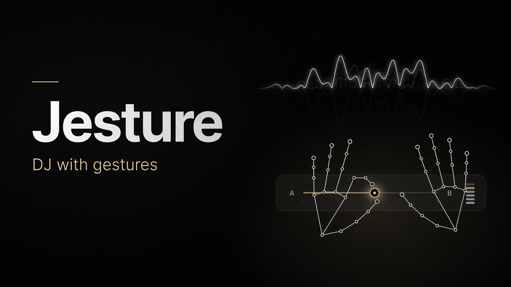

<div align="center">



# Jesture
### DJ with gestures

A browser-based DJ mixer controlled with your hands and a webcam.

**[Try the live demo](https://belle-3d.github.io/Jesture/)**

[](https://developers.google.com/mediapipe)
[](https://tonejs.github.io)
[](https://vite.dev)
[](https://developer.mozilla.org/docs/Web/JavaScript)

</div>

Load two tracks, prepare your cues, and use gestures to control playback, crossfade between songs, and adjust the sound.

Jesture is built on [Lumaire](https://github.com/sehgalbhavya/Lumaire) by [sehgalbhavya](https://github.com/sehgalbhavya), with a redesigned interface, cue preparation tools, and refined gesture handling.

## Quick start

Open the **[live demo](https://belle-3d.github.io/Jesture/)** in Chrome or Edge.

1. Allow camera access when prompted.
2. Click the page once to enable audio.
3. Load an audio file into each deck.
4. Open **Edit Cues** to save Cue 1 and Cue 2 for each track.
5. Position your hands in view of the camera and start mixing.

## The interface

The interface brings together your tracks, mixer controls, and live hand tracking.

| Area | What it shows and does |
| --- | --- |
| **Deck A and Deck B** | Load your tracks and see their waveforms, playback position, and saved cue markers. Each deck can be controlled independently. |
| **Cue preparation panel** | Open **Edit Cues** to choose and save two positions in each track. Use them as starting points for transitions or to return to a particular moment. |
| **Waveform markers** | **Pink marks Cue 1** and **green marks Cue 2**. Each deck has its own saved cues. |
| **Crossfader** | Controls the balance between Deck A and Deck B as you transition between tracks. |
| **Master volume** | Controls the overall output level of the mix. |
| **Bass and treble** | Shape the low and high frequencies of the sound. |
| **Live camera and hand overlays** | Show the tracked positions of your hands so you can see how your movements relate to the controls. |
| **Audio spectrum** | Visualises the frequency content of the playing audio. |

### Gesture feedback

Hand overlays give you visual feedback while you mix. During a pinch-and-drag gesture, control dots show the interaction used for **crossfade** or **master volume**.

The hand tags identify the tracked hands and use the same typography as the rest of the interface.

## Gesture controls

Your **left hand** controls Deck A, crossfade, and treble. Your **right hand** controls Deck B, master volume, and bass.

| Hand | Gesture | Action |
| --- | --- | --- |
| Left | Quick pinch and release | Play or pause Deck A |
| Left | Hold a pinch and move horizontally | Adjust crossfade |
| Left | Make a fist and move vertically | Adjust treble |
| Left | Hold up one finger | Trigger Cue 1 on Deck A |
| Left | Hold up two fingers | Trigger Cue 2 on Deck A |
| Right | Quick pinch and release | Play or pause Deck B |
| Right | Hold a pinch and move vertically | Adjust master volume |
| Right | Make a fist and move vertically | Adjust bass |
| Right | Hold up one finger | Trigger Cue 1 on Deck B |
| Right | Hold up two fingers | Trigger Cue 2 on Deck B |

A quick pinch acts as a tap. Holding the pinch and moving turns it into a drag.

A closed fist takes priority over pinch and cue gestures, helping prevent accidental playback changes while adjusting EQ.

## The story

I am not a DJ. I do not have a single musical bone in my body. But I love the idea of using your hands to steer sound in the air.

When I found [Lumaire](https://github.com/sehgalbhavya/Lumaire), it clicked: a two-deck mixer in the browser, controlled through a webcam. It gave me a foundation to explore gesture interaction through music.

Jesture is my extension of that idea. The focus is on mixing music that already exists: loading tracks, choosing cues, moving between decks, and shaping the sound with your hands.

My work centres on the experience of using it: redesigning the console, making cues visible on the waveforms, adding a cue preparation panel, and refining how gestures are recognised.

It is also a project for learning how to take an existing open-source foundation, develop my own product direction, and build something I can use and share.

## Built on Lumaire

[Lumaire](https://github.com/sehgalbhavya/Lumaire) was created by [sehgalbhavya](https://github.com/sehgalbhavya) as part of a multimodal interaction course at KTH Royal Institute of Technology.

Jesture retains its core two-deck gesture mixer and extends it with:

- A redesigned mixer console.
- A cue preparation panel for each deck.
- Pink and green cue markers on the waveforms.
- Refined gesture handling to reduce accidental triggers.

Credit for the original foundation belongs to Lumaire and its creator.

## How it works

**MediaPipe Hands** tracks 21 landmarks on each hand through the webcam. The gesture engine interprets those landmarks and updates a shared state store.

The audio and visual engines read that state to update the sound and interface.

| Component | Responsibility |
| --- | --- |
| **Gesture engine** | Detects pinches, fists, and cue gestures; distinguishes taps from drags; handles mirror correction. |
| **State store** | Holds playback state, cue information, crossfade, volume, and EQ values. |
| **Audio engine** | Uses Tone.js for two-deck playback, EQ, and crossfading. |
| **Visual engine** | Draws the camera view, hand overlays, mixer feedback, and audio spectrum. |

Playback uses the Web Audio clock through Tone.js, allowing audio timing to run independently of visual rendering.

Bass and treble use shelf filters below 200 Hz and above 3 kHz, with a range of ±12 dB.

## Run locally

You will need **Node.js 20 or newer**. A webcam is needed for gesture controls.

```bash
git clone https://github.com/Belle-3d/Jesture.git
cd Jesture
npm install
npm run dev
```

Open the local URL printed by Vite.

To create a production build:

```bash
npm run build
```

## Project structure

| File | Purpose |
| --- | --- |
| `index.html` | App shell and mixer panel |
| `src/main.js` | App setup, track loading, keyboard and mouse controls |
| `src/gestureEngine.js` | Hand landmark interpretation and gesture detection |
| `src/audioEngine.js` | Playback, EQ, and crossfade |
| `src/visualEngine.js` | Camera rendering, hand overlays, mixer feedback, and spectrum |
| `src/stateStore.js` | Shared state and subscriptions |
| `src/style.css` | Interface styling |
| `public/banner.png` | README banner |
| `.github/workflows/deploy-pages.yml` | GitHub Pages build and deployment |
